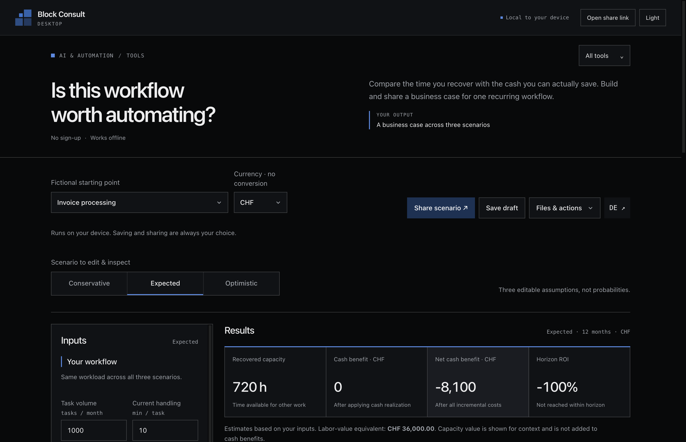
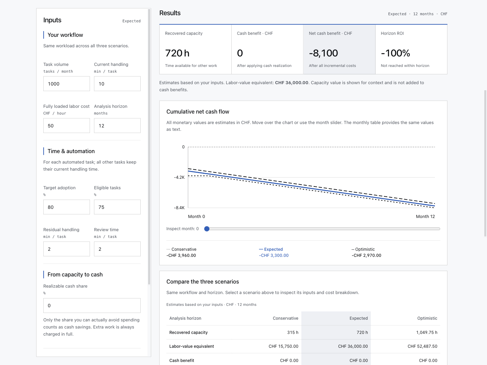

<a href="https://www.blockconsult.org">
  <picture>
    <source media="(prefers-color-scheme: dark)" srcset="public/blockconsult-logo.png">
    
  </picture>
</a>

# AI Automation ROI Simulator

Build a business case for one recurring workflow. Enter workload, handling time, labor cost and automation assumptions, then compare recovered capacity, cash benefit, incremental costs and payback across conservative, expected and optimistic scenarios.

An offline desktop tool from [Block Consult](https://www.blockconsult.org), available in English and German, with light and dark themes.

[](https://github.com/blockconsult-org/ai-roi/releases/latest) [](LICENSE) · [Platform builds](https://github.com/blockconsult-org/ai-roi/actions/workflows/release.yml)

**[Download for macOS or Windows](https://github.com/blockconsult-org/ai-roi/releases/latest)** · [Use in your browser](https://www.blockconsult.org/tools/ai-roi) · [Report an issue](https://github.com/blockconsult-org/ai-roi/issues)



## What you can do

- Start from an invoice-processing, enquiry-triage or recurring-reporting example and replace its assumptions.
- Model adoption, eligible tasks, residual handling and review time separately for all three scenarios.
- Include implementation, software, usage and maintenance costs, plus implementation delay and adoption ramp.
- Keep recovered capacity separate from cash savings. Only the cash-realization share contributes positive labor savings; additional labor counts as a cost.
- Compare cumulative cash, break-even, ROI and monthly detail, then export JSON, a PNG summary or PDF.

## Get started

1. Choose a **Fictional starting point** and currency. Currency changes the unit label; it does not convert amounts.
2. In **Inputs**, enter your workflow volume, current handling time, labor cost and analysis horizon. Adjust automation, costs and timing for each scenario.
3. Open **Results** to compare the business cases and inspect the selected scenario. Review the cash-realization assumption before relying on savings.
4. Choose **Save draft** or **Files & actions → Export JSON** to keep your assumptions and results.

## Screenshots



Results from the fictional invoice-processing example. The chart compares the three scenarios over the analysis horizon; the selected scenario supplies the headline figures. Both screenshots show the actual desktop app with fictional example data or its starting workspace.

## Download and install

| Platform | Download | Installation |
| --- | --- | --- |
| macOS, Apple silicon and Intel | Universal `.dmg` | Open the disk image and drag the app to Applications. |
| Windows 11, Intel/AMD 64-bit | `windows-x64-setup.exe` | Run the per-user installer; administrator rights are not required. |
| Windows, portable | `windows-x64-portable.exe` | Run directly without installing. |

Release notes state the signing and notarization status of each download. Unsigned Windows releases may show a publisher warning. macOS requires macOS 13 or later. Check `SHA256SUMS.txt` against the downloaded file using `shasum -a 256` (macOS) or `Get-FileHash -Algorithm SHA256` (PowerShell). Download only from this repository's Releases page.

## Your data

Calculations and editing run locally without an internet connection, account or API key. The app has no analytics, telemetry, cloud synchronization or automatic uploads.

Use **Save draft** for a local draft or **Files & actions → Export JSON** for a portable copy. Saving and loading are explicit; edits are not saved automatically. Shared snapshots open read-only, and **Make a copy** creates an editable version without changing the saved draft until you save.

JSON models and browser share links are compatible with the Block Consult browser tool. **Open share link** lets you inspect a shared scenario in the desktop app. Save or export before opening a share link; navigation replaces the open workspace. Share links contain readable, encoded snapshots and are not encrypted. Review the sharing preview and the option to include authored text before creating one.

Exports use native file-save dialogs. **File → Save report as PDF** saves a local PDF. Website and evidence links open in your default browser; unknown evidence destinations require confirmation.

## Run from source

Install Node.js 24 or newer, then:

```sh
git clone https://github.com/blockconsult-org/ai-roi.git
cd ai-roi
npm ci
npm run build
npm start
```

`npm run dev` runs the renderer in a browser. `npm test` checks the model and desktop security boundaries. `npm run test:desktop` launches real Electron and exercises offline rendering, themes, localization, exports and isolation. Run `npm run build` first.

```sh
npm run verify
npm run dist -- --mac --universal  # on macOS
npm run dist -- --win --x64       # on Windows
```

## Project layout

| Path | Responsibility |
| --- | --- |
| `tools/ai-roi/` | Models, calculations, localized copy, UI and exports |
| `src/` | Desktop frame and small browser-framework adapters |
| `desktop/` | Sandboxed Electron host, local asset protocol, native PDF saving |
| `tests/` | Calculation regressions and real desktop integration checks |
| `.github/workflows/release.yml` | Tests and platform builds; draft releases for version tags |

## Release and maintenance

See the [release instructions](docs/RELEASING.md). Releases are manual downloads; the app does not silently update. Keep the Electron runtime current when maintaining a fork.

The three scenarios are editable assumptions, not probabilities or confidence intervals. Recovered hours are capacity, not automatically cash savings. Results depend on the chosen inputs and do not predict realized returns.

## Contributing and license

Read the [contribution guide](CONTRIBUTING.md) before opening a pull request. Report vulnerabilities privately through the [security policy](SECURITY.md).

[MIT](LICENSE) · Copyright © 2026 Block Consult GmbH. The license covers the code; it does not grant rights to use Block Consult’s name or logo as an endorsement.
